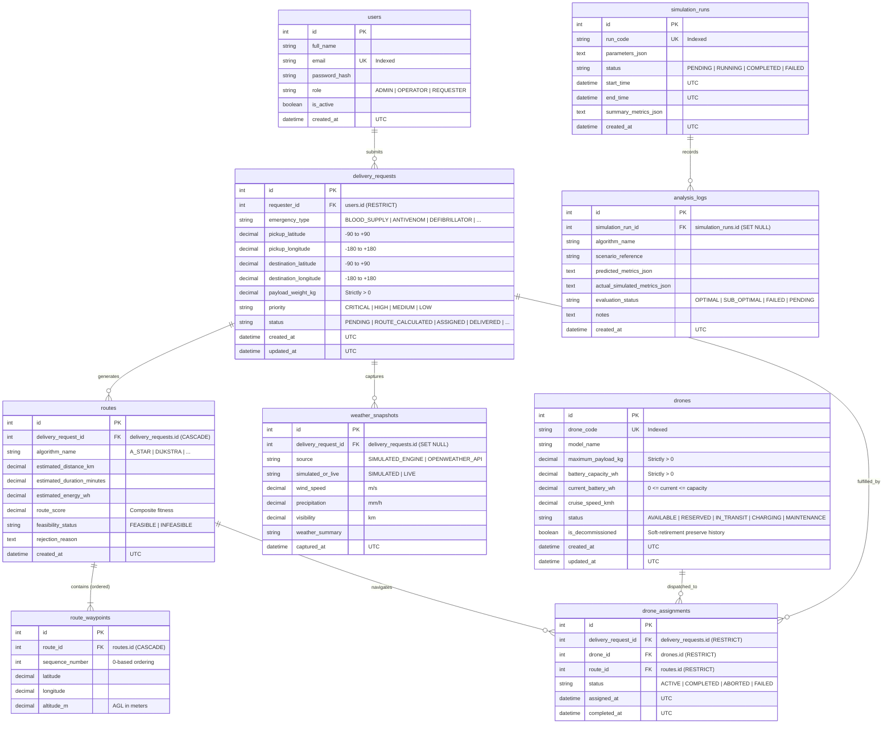

# Smart Multipurpose Emergency Drone Delivery and Route Optimization System

A modular, simulation-driven emergency dispatch and route optimization platform built for rapid medical, disaster relief, and high-priority supply transit.

---

## 1. Project Overview

The **Smart Multipurpose Emergency Drone Delivery and Route Optimization System** is a full-stack engineering solution designed to simulate, schedule, and optimize autonomous drone delivery operations for mission-critical and emergency supplies (e.g., blood packages, antivenoms, defibrillators, disaster kits).

The system integrates real-time geospatial tracking (via Leaflet.js and OpenStreetMap), multi-criteria route optimization algorithms, dynamic battery/payload depletion modeling, and persistent audit logging via MySQL and Pandas data pipelines.

> **Note on Scope**: In accordance with the engineering specification, this system operates in **simulation mode**. It models physical constraints (speed, payload limits, battery discharge, no-fly zones, and weather factors) through software mathematical models without requiring physical drone hardware control.

---

## 2. Technology Stack

| Layer | Technology | Purpose |
| :--- | :--- | :--- |
| **Frontend** | HTML5, CSS3, Vanilla JavaScript (ES6+) | Interactive operator dashboard, status telemetry, request intake forms |
| **Map Engine** | Leaflet.js, OpenStreetMap | Geospatial rendering, live path interpolation, waypoint and base station markers |
| **Backend** | Python 3.10+, Flask | Modular REST API service, application factory pattern, service-layer orchestration |
| **Database** | MySQL (with SQLite dev fallback), SQLAlchemy, Flask-Migrate | Normalized relational schema for drones, orders, routes, assignments, and telemetry |
| **Analytics** | Pandas, NumPy | Route analysis, energy consumption metrics, dispatch efficiency reports |
| **Testing** | Pytest, Pytest-Cov | Unit testing, integration testing, and API contract test automation |
| **Version Control** | Git | Distributed version management and change traceability |

---

## 3. Architecture & Modular Design

The project uses the **Flask Application Factory Pattern** combined with strict separation of concerns:

```text
smart-emergency-drone-system/
│
├── app/
│   ├── __init__.py          # Flask Application Factory (create_app)
│   ├── config.py            # Environment-aware configurations (Dev, Test, Prod)
│   ├── extensions.py        # Extensions lifecycle management (SQLAlchemy, Migrate)
│   ├── routes/              # HTTP Route Blueprints & Request Handlers
│   │   ├── __init__.py
│   │   └── health.py        # Health-check and system readiness endpoints
│   ├── models/              # Normalized Relational Models
│   │   ├── __init__.py      # Package export for models and enums
│   │   ├── user.py          # Users & backend role-based permissions
│   │   ├── drone.py         # Drones, capacities, and state transitions
│   │   ├── delivery_request.py # Emergency intake & coordinate validation
│   │   ├── route.py         # Planned routes & feasibility scores
│   │   ├── route_waypoint.py# Ordered simulation waypoints
│   │   ├── weather_snapshot.py # Weather snapshots with explicit units
│   │   ├── drone_assignment.py # ACID mission dispatches & conflict locking
│   │   ├── simulation_run.py   # Discrete-event simulation runs
│   │   └── analysis_log.py  # Prediction vs actual telemetry logs
│   ├── services/            # Pure Business & Database Access Services
│   │   ├── __init__.py
│   │   ├── user_service.py  # User authentication & RBAC authorization
│   │   ├── drone_service.py # Fleet management & status transition rules
│   │   └── assignment_service.py # Transactional dispatch & conflict prevention
│   ├── templates/           # Server-side HTML Jinja2 templates
│   └── static/              # Client-side static assets (CSS, JS, images)
│
├── migrations/              # Alembic / Flask-Migrate versioned migrations
│   └── versions/
│       └── d0eddf8e4e58_initial_normalized_database_schema.py
├── scripts/                 # Maintenance, migration, and simulation seed scripts
│   ├── init_db.py           # Database auto-creation & schema initializer
│   └── seed_db.py           # Demonstration dataset seeder
├── instance/                # Local runtime instances / sqlite fallbacks
│   └── drone_system.db
├── tests/                   # Pytest test suite (20 automated tests)
│   ├── __init__.py
│   ├── conftest.py          # App context, HTTP client, and clean DB fixtures
│   ├── test_health.py       # Health endpoint unit and integration tests
│   ├── test_user_model.py   # User hashing, roles, and RBAC tests
│   ├── test_drone_model.py  # Drone state transitions and lifecycle tests
│   ├── test_delivery_request_and_routes.py # Coordinate bounds, routes, and waypoints
│   ├── test_drone_assignment_service.py   # Transactional dispatch & conflict prevention
│   └── test_simulation_and_analysis_logs.py # Simulation lifecycle and logs
├── .env.example             # Template for required environment variables
├── .gitignore               # Ignored files (virtualenvs, secrets, cache)
├── requirements.txt         # Pinned and compatible Python dependencies
├── run.py                   # Application entry point script
└── README.md                # Project documentation and engineering roadmap
```

---

## 4. Entity-Relationship (ER) Architecture

The database is normalized to 3NF with strict relational integrity, cascade constraints, composite indexes, and UTC timestamp auditing.



---

## 5. Security & Data Integrity Rules

1. **Backend Role-Based Access Control (RBAC)**:
   - Authorization is enforced programmatically in the service layer (`app/services/user_service.py`), not by hiding client-side UI elements.
   - Roles:
     - `ADMIN`: User management, drone registration, fleet configuration, full analytics.
     - `OPERATOR`: Drone dispatch, mission abort, telemetry monitoring, simulation runs.
     - `REQUESTER`: Emergency order submission and tracking own delivery requests.
2. **ACID Transaction Guarantees & Conflict Prevention**:
   - `AssignmentService.create_assignment()` wraps dispatch in a database transaction.
   - Prevents multiple concurrent active missions for the same drone or delivery request.
   - Verifies drone payload capacity $\ge$ cargo weight and available battery $\ge$ route energy + 15% safety buffer.
   - Automatic rollback upon any constraint or validation failure.
3. **Data Audit Retention**:
   - Drones are never hard-deleted when taken out of service; `is_decommissioned = True` preserves historical missions and flight logs.
   - Foreign key constraints use `ON DELETE RESTRICT` for users, drones, and completed assignments.
4. **Coordinate & Physical Boundary Validation**:
   - Latitude validated strictly between $-90.0^{\circ}$ and $+90.0^{\circ}$.
   - Longitude validated strictly between $-180.0^{\circ}$ and $+180.0^{\circ}$.
   - Payload and battery metrics must be strictly positive.

---

## 6. Quickstart & Setup Guide (Windows PowerShell)

### Step 1: Open Terminal in Project Directory
```powershell
Set-Location "C:\Users\Sahiti\.gemini\antigravity\scratch\smart-emergency-drone-system"
```

### Step 2: Activate Python Virtual Environment
```powershell
.\.venv\Scripts\Activate.ps1
```

### Step 3: Install Dependencies
```powershell
pip install -r requirements.txt
```

### Step 4: Configure Environment Variables
Copy `.env.example` to `.env` if not already present:
```powershell
Copy-Item .env.example .env
```
Default MySQL parameters are configured in `.env`.
*For offline or local development without a running MySQL server, you can set SQLite fallback in `.env`:*
```ini
DATABASE_URL=sqlite:///instance/drone_system.db
```

### Step 5: Initialize Database & Apply Migrations
Execute the automated database setup script:
```powershell
python scripts/init_db.py
```
Or use Flask-Migrate:
```powershell
flask --app run.py db upgrade
```

### Step 6: Seed Demonstration Dataset
Populate demo users (Admin, Operator, Requester), drones, sample emergency requests, routes, waypoints, and simulation logs:
```powershell
python scripts/seed_db.py
```

### Step 7: Run Automated Test Suite
Execute the 20 automated unit and integration tests:
```powershell
pytest -v
```

### Step 8: Start the Application Server
```powershell
python run.py
```

Verify the health check endpoint:
```powershell
Invoke-RestMethod -Uri "http://127.0.0.1:5000/api/health" -Method Get
```

---

## 7. Phased Development Roadmap

| Phase | Title | Scope & Deliverables | Status |
| :---: | :--- | :--- | :---: |
| **Phase 1** | **Foundation & Architecture** | Project structure, environment configuration, application factory, dependency definition, health-check endpoint, and automated test suite. | **Completed** |
| **Phase 2** | **Data Models & Persistence Layer** | Normalized 3NF MySQL/SQLAlchemy schema, Flask-Migrate versioning, RBAC model, state machines, conflict prevention transactions, demonstration seeder, and test suite. | **Completed** |
| **Phase 3** | **Route Optimization Engine** | Haversine distance, Dijkstra/A* routing with no-fly zone avoidance, battery and payload feasibility validator. | Upcoming |
| **Phase 4** | **Delivery Simulation Engine** | Discrete-time simulation service, waypoint interpolation, simulated telemetry broadcast, incident handling (battery low, rerouting). | Planned |
| **Phase 5** | **Interactive Web Dashboard** | Leaflet.js real-time drone tracking map, dispatch console, order submission form, emergency telemetry metrics. | Planned |
| **Phase 6** | **Analytics & System Verification** | Pandas analytics pipeline for post-flight metrics, full integration test suite, deployment documentation. | Planned |

---

## 8. Phase 2 Acceptance Criteria

- [x] Normalized 3NF models designed for Users, Drones, DeliveryRequests, Routes, RouteWaypoints, WeatherSnapshots, DroneAssignments, SimulationRuns, and AnalysisLogs.
- [x] SQLAlchemy configured via `.env` with MySQL default and SQLite development fallback.
- [x] Versioned migration repository generated with Flask-Migrate (`migrations/`).
- [x] Automated database initializer (`scripts/init_db.py`) handling database creation and graceful failure reporting.
- [x] Demonstration dataset seeder (`scripts/seed_db.py`) with labeled users, drones, requests, and simulated routes.
- [x] Drone state machine enforcing allowed status transitions (`AVAILABLE`, `RESERVED`, `IN_TRANSIT`, `CHARGING`, `MAINTENANCE`).
- [x] Transactional dispatch service (`AssignmentService`) preventing conflicting active assignments.
- [x] Backend role-based permissions matrix implemented and verified.
- [x] Full Pytest test suite with 20 passing unit/integration tests across all entities and service layers.
- [x] Mermaid ER diagram and table relationships documented in `README.md`.
