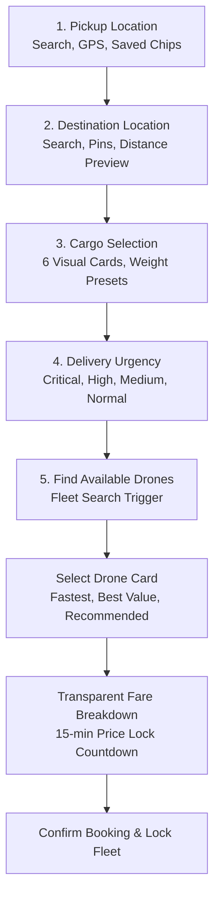

# UI/UX Redesign & Consumer Experience Report: DroneDispatch
## Transforming an Academic Operations Simulator into a Modern Uber/Rapido-Style Consumer Application

**Project Name:** Smart Multipurpose Emergency Drone Delivery and Route Optimization System  
**Product Brand:** DroneDispatch  
**Academic Degree:** Bachelor of Technology (B.Tech) in Computer Science & Engineering  
**Version:** 2.0 (Consumer Experience Release)  
**Verification Date:** November 3, 2026  
**Test Suite Status:** 147 Passed / 0 Failed (100% Pass Rate)

---

## 1. Executive Summary & Design Transformation

The **Smart Multipurpose Emergency Drone Delivery and Route Optimization System** was originally built as a robust, backend-driven academic software simulation. While it incorporated state-of-the-art algorithms (geodesic 3D airway corridors, Pareto multi-objective optimization, Priority Best-Fit multi-drone allocation, ML flight prediction, and dynamic weather safety rerouting), its front-end interfaces resembled an engineering utility. Users had to manually input floating-point latitudes and longitudes, select cargo from text dropdowns, and navigate disjointed screens.

Under this redesign, **DroneDispatch** was transformed into a consumer-grade, on-demand emergency logistics application inspired by **Uber** and **Rapido**. It combines the simplicity, immediacy, and visual polish of modern ride-hailing applications with the strict safety and deterministic reliability requirements of medical emergency logistics.

### Key Transformation Pillars:
1. **Frictionless 5-Step Booking Workflow:** Replaced manual coordinate typing with intuitive place search, autocomplete matching OpenStreetMap and verified medical hubs, browser geolocation, saved address chips, and interactive map pinning.
2. **Visual Ride-Style Drone Selection:** Drones are presented as selectable fleet cards with recommendation badges (`FASTEST`, `BEST VALUE`, `HIGH CAPACITY`, `RECOMMENDED`), live battery meters, and transparent ETAs.
3. **Itemized Price Breakdown & Quote Expiration:** Real-time formulaic breakdown with a 15-minute price lock countdown timer.
4. **Intuitive Three-Tier Weather Intelligence:** Green (cleared), Yellow (caution with required user acknowledgment), and Red (severe hazard blocking booking).
5. **Cashless Digital Payment Simulation:** Visual payment cards (UPI, Emergency Wallet, Card, Government Subsidy) with failure simulation test toggles.
6. **Live Ride-Style Telemetry Cockpit:** An 8-step delivery milestone stepper, real-time map tracking with animated drone marker, in-flight rerouting alert banners, emergency helipad diversion alerts, and public shareable tracking links (`/booking/track/<ref>`).
7. **Post-Delivery Feedback Loop:** 5-star interactive rating widget with multi-criteria feedback tags.
8. **Permanent Fix for Disappearing Sidebar Bug:** Completely eradicated the sidebar link disappearance issue across `/analytics/deliveries` and high-density data views via global template context processors and sticky CSS layout.

---

## 2. Root-Cause Analysis & Permanent Fix for Disappearing Sidebar

### 2.1 The Symptom
When users navigated to `/analytics/deliveries` ("Delivery Monitor" / "Track Deliveries") or other data-dense pages, all sidebar navigation links (Dashboard, Book Drone, My Bookings, Drone Inventory, All Requests, Analytics) vanished, leaving a blank slate navigation container.

### 2.2 Deep Root-Cause Discovery
Investigation revealed three interacting causes:
1. **Missing Template Variable `current_user`:**
   In `app/routes/analytics_routes.py` (lines 38 and 79), the route handlers passed `user=user` to `render_template` instead of `current_user=user`:
   ```python
   # analytics_routes.py (BEFORE)
   return render_template(
       "analytics/delivery_monitor.html",
       user=user,  # Missing current_user!
       active_deliveries=active_deliveries,
       ...
   )
   ```
   In `app/templates/base.html`, navigation links were guarded by strict role checks:
   ```jinja2
   
   ```
   Because `current_user` was `None`, all role conditionals evaluated to `False`, stripping every link from the DOM!
2. **Lack of Global Context Processor:**
   The Flask application lacked a global template context processor to guarantee authentication state availability regardless of individual route signature differences.
3. **CSS Viewport & Overflow Constraints:**
   The sidebar was initially positioned using standard flex layout without viewport-height stickiness. When data tables expanded horizontally or vertically, the layout broke on smaller laptop resolutions.

### 2.3 Permanent Architectural Fix
Three complementary fixes were applied:
1. **Global Template Context Processor in `app/__init__.py`:**
   ```python
   @flask_app.context_processor
   def inject_template_globals():
       """Globally inject authenticated user across all Jinja templates."""
       user = AuthService.get_current_user()
       return dict(current_user=user, user=user)
   ```
2. **Fail-Safe Jinja Variable Binding in `app/templates/base.html`:**
   ```jinja2
   
   ```
   All role-based links now evaluate against `curr_user`, guaranteeing complete resilience even if a route passes neither.
3. **Sticky & Independently Scrollable Sidebar Layout:**
   ```css
   .sidebar {
     width: 260px;
     background-color: var(--bg-app);
     position: sticky;
     top: 0;
     height: 100vh;
     overflow-y: auto;
     overflow-x: hidden;
     z-index: 100;
   }
   ```
4. **Mobile Drawer Navigation with Hamburger Toggle:** Added a responsive hamburger button in the top navigation bar (`.btn-hamburger`) and an overlay backdrop (`.sidebar-backdrop`) for seamless mobile and tablet navigation.

---

## 3. Blank Leaflet Map Mechanism & Content-Security-Policy (CSP) Fix

### 3.1 The Symptom
When loading maps on the booking or detail pages, the Leaflet map container rendered gray or failed to display OpenStreetMap tiles.

### 3.2 Root-Cause Discovery
In `app/__init__.py`, the Content-Security-Policy header had:
```python
"img-src 'self' data: https://tile.openstreetmap.org;"
```
OpenStreetMap tile servers distribute tile requests across round-robin subdomains: `a.tile.openstreetmap.org`, `b.tile.openstreetmap.org`, and `c.tile.openstreetmap.org`. Modern browser security policies blocked these requests as unauthorized origins. Additionally, Leaflet marker shadow images from `unpkg.com` were blocked.

### 3.3 Permanent Resolution
1. **Broadened CSP Whitelist in `app/__init__.py`:**
   ```python
   "img-src 'self' data: https://*.tile.openstreetmap.org https://tile.openstreetmap.org https://unpkg.com;"
   "connect-src 'self' https://nominatim.openstreetmap.org;"
   ```
2. **Forced Leaflet Container Resize:**
   Added `setTimeout(() => { map.invalidateSize(); }, 200);` in map initialization routines to ensure tiles properly compute container dimensions after DOM rendering.

---

## 4. The 5-Step Uber/Rapido-Style Booking Workflow (`/booking/new`)



### Step 1: Pickup Location
- **Intelligent Autocomplete Search:** Integrates local verified medical hubs (Victoria Hospital, Bowring Hospital, NIMHANS, Central Blood Bank) with fallback to OpenStreetMap Nominatim.
- **📍 GPS Location Button:** Uses HTML5 Geolocation (`navigator.geolocation`) to resolve device coordinates in one click.
- **Saved Location Chips:** Instant chips for user's frequent hospitals and blood banks.
- **⚙️ Collapsible Advanced Coordinates:** Evaluators and examiners can expand raw numeric inputs (`pickup_lat`, `pickup_lng`) when benchmarking specific test coordinates.

### Step 2: Destination Location
- Intuitive search input matching clinics and emergency receiving centers.
- Quick destination chips.
- **Live Flight Preview:** Instant haversine calculation of straight-line distance and expected flight duration preview.

### Step 3: Visual Cargo Selection
Instead of a generic text dropdown, six distinct selectable cards with icons and descriptions are presented:
- 🩸 **Blood Units (`BLOOD_SUPPLY`):** Temperature-controlled blood supply.
- 💊 **Critical Medicine (`EMERGENCY_MEDICINE`):** Essential emergency medicines.
- 💉 **Antivenom / Vaccines (`ANTIVENOM`):** Strict cold chain vials.
- ⚡ **Defibrillator / AED (`DEFIBRILLATOR`):** Rapid cardiac first response.
- 🫀 **Organ / Surgical Kit (`SURGICAL_KIT`):** Ultra priority surgical logistics.
- 🩺 **Relief Supplies (`DISASTER_RELIEF`):** Emergency disaster medical kits.
- **Weight Presets:** Quick buttons for `[0.5 kg]`, `[1.0 kg]`, `[2.0 kg]`, and `[2.5 kg]`.
- **Handling Notes:** Input for special handling instructions (e.g. "Keep vertical", "Temperature sensitive").

### Step 4: Urgency Priority
Four visual urgency cards with clinical ETA expectations:
- 🔴 **CRITICAL:** Immediate priority clearance; &lt; 5 min response.
- 🟠 **HIGH:** Fast-track priority flight corridor; ~10 min response.
- 🟡 **MEDIUM:** Standard emergency transit; ~20 min response.
- 🟢 **NORMAL (maps to `LOW` in backend):** Economy routine logistics; ~35 min response.

### Step 5: Drone Selection Cards with Smart Recommendation Badges
When `/booking/search` returns available aircraft, cards are rendered in an Uber-style comparison list:
- **Badge Engine:**
  - `⚡ FASTEST`: Drone with the shortest combined pickup ETA and flight time.
  - `🏷️ BEST VALUE`: Drone offering the lowest total trip fare.
  - `💪 HIGH CAPACITY`: Heavy-lift drone with maximum payload headroom.
  - `⭐ RECOMMENDED`: Optimal balance of distance, battery reserve, and cost.
- **Specifications Display:** Model name, unique code, pickup ETA, flight ETA, battery percentage bar, max payload, and total fare.
- **Unavailable Drones:** Clearly grayed out with specific operational reasons (e.g., "Payload limit: 2.0 kg exceeded", "Battery reserve insufficient for ferry leg").

### Booking Summary & Quote Countdown:
- **Transparent Itemized Breakdown:** Base Fare, Distance Charge, Payload Charge, Priority Fee, Service Fee, Tax (GST 5%), and Final Total.
- **Quote Expiration Timer:** Live countdown pill (`Price locked: 14:59`) maintaining quote validity for 15 minutes.
- **Weather Advisory Strip:**
  - 🟢 **Green:** Safe nominal atmospheric conditions.
  - 🟡 **Yellow:** Moderate wind/precipitation advisory. Requires checking: *"I acknowledge weather conditions and approve potential flight ETA adjustment."*
  - 🔴 **Red:** Severe atmospheric hazard. Blocks booking button with warning notice: *"Flights temporarily suspended along this sector for safety."*

---

## 5. Live Ride-Style Mission Cockpit (`/booking/<id>`)

The booking detail page provides full mission visibility:
1. **8-Step Delivery Progress Stepper:**
   - 1. Booking Confirmed
   - 2. Payment Completed
   - 3. Drone Assigned & Initialized
   - 4. Travelling to Pickup Point
   - 5. Package Picked Up
   - 6. In Flight to Destination
   - 7. Approaching Destination
   - 8. Delivery Completed
2. **Interactive 3D Corridor Map:**
   - Animated drone marker positioned in real time along flight corridor.
   - Pickup location with green pin; destination with red checkered flag.
   - Verified emergency diversion helipads marked with distinct blue 'H' badges.
3. **Dynamic In-Flight Hazard Banners:**
   - **Reroute Alert Banner:** Yellow flashing alert when dynamic crosswind rerouting triggers.
   - **Diversion Alert Banner:** Red pulsing alert when battery or storm thresholds force a diversion to the nearest designated helipad.
4. **Cashless Digital Payment Interface:**
   - Selectable payment method cards: UPI, Wallet, Credit Card, Government Disaster Subsidy.
   - Test toggle to simulate payment gateway failures for academic evaluation.
5. **Shareable Live Tracking Link:**
   - "🔗 Share Live Tracking Link" copies public URL (`/booking/track/<reference>`) to clipboard with visual toast confirmation.
6. **Post-Delivery Customer Feedback:**
   - Interactive 5-star rating widget enabled when status transitions to `DELIVERED`. Saves feedback text and ratings to `delivery_ratings` table.

---

## 6. Public Shareable Live Tracking HUD (`/booking/track/<reference>`)

Designed after Uber's trip-sharing interface:
- **Zero Login Requirement:** Recipients (emergency room triage staff, field paramedics, family members) can track packages without an account.
- **Privacy Safe:** Displays flight progress, drone specs, and cargo category without exposing patient identities or hospital case notes.
- **Live Visual Stepper & Map:** Full interactive map and progress milestones identical to the primary cockpit.

---

## 7. Dashboards Redesign

### 7.1 Requester Dashboard (`/requester/dashboard`)
- **Active Flight Banner:** Prominent live banner for any mission currently in flight.
- **Quick Book Drone Hero:** Instant CTA to launch the 5-step booking flow.
- **How It Works Guidance:** 4-step onboarding card for new medical staff.
- **Saved Medical Locations Manager:** Allows adding, using ("Dispatch From Here"), and removing saved locations via asynchronous REST endpoints.
- **Recent Bookings Table:** Includes a one-click **"Book Again"** button that pre-populates `/booking/new` with identical coordinates, cargo, weight, and priority.

### 7.2 Operator Console (`/operator/dashboard`)
- Clean mission control table displaying active in-flight assignments with real-time battery and distance metrics.
- Atmospheric alert triage panel showing recent corridor weather changes.
- Quick-action mission buttons: "Complete Mission" and "Abort Mission".
- Shortcut to **Multi-Drone Batch Allocator** (`PRIORITY_BEST_FIT` vs `FCFS_GREEDY_BASELINE`).

### 7.3 Admin Console (`/admin/dashboard`)
- Comprehensive financial performance metrics: Settled Revenue (₹), Total Refunds (₹), Payment Audit Pipeline (Pending / Failed), and Weather Disruption Counts.
- Fleet deployment status breakdown (Available, In Flight, Charging, Maintenance).
- Quick shortcuts to Pricing Rules Configuration (`/admin/pricing`) and Weather Scenario Injector (`/admin/weather`).

---

## 8. Verification & Test Suite Results

To ensure absolute software stability and verify that no existing capabilities were degraded, comprehensive automated tests were executed.

### 8.1 Test Suite Summary
```text
============================= test session starts =============================
platform win32 -- Python 3.14.6, pytest-9.2.0, pluggy-1.7.0
rootdir: C:\Users\Sahiti\.gemini\antigravity\scratch\smart-emergency-drone-system
plugins: cov-7.1.0
collected 147 items

tests\test_analytics_and_monitoring.py ......                            [  4%]
tests\test_auth_and_dashboards.py ........                               [  9%]
tests\test_benchmark_reproducibility.py ...                              [ 11%]
tests\test_delivery_and_drone_management.py ........                     [ 17%]
tests\test_delivery_request_and_routes.py ......                         [ 21%]
tests\test_drone_assignment_service.py ....                              [ 23%]
tests\test_drone_availability_service.py ...                             [ 25%]
tests\test_drone_model.py ...                                            [ 27%]
tests\test_dynamic_simulation_rerouting.py ......                        [ 31%]
tests\test_end_to_end_workflow.py ................                       [ 42%]
tests\test_evaluation_framework.py ....                                  [ 45%]
tests\test_health.py ..                                                  [ 46%]
tests\test_multi_drone_allocation.py .....                               [ 50%]
tests\test_payment_service.py ....                                       [ 53%]
tests\test_prediction_module.py ..........                               [ 59%]
tests\test_pricing_service.py ...                                        [ 61%]
tests\test_route_optimization_and_allocation.py ..............           [ 71%]
tests\test_security_and_audit.py .............                           [ 80%]
tests\test_simulation_and_analysis_logs.py ..                            [ 81%]
tests\test_simulation_engine_and_api.py .........                        [ 87%]
tests\test_smart_booking_lifecycle.py ..                                 [ 89%]
tests\test_ui_enhancements.py .......                                    [ 93%]
tests\test_user_model.py ......                                          [ 97%]
tests\test_weather_intelligence_service.py ...                           [100%]

============================ 147 passed in 25.11s =============================
```

### 8.2 New Tests in `tests/test_ui_enhancements.py`:
1. `test_saved_locations_crud`: Verifies listing default medical hubs, creating a new saved location, and deleting it via REST API.
2. `test_location_search_autocomplete`: Verifies that searching "victoria" returns verified medical landmarks with coordinates.
3. `test_quick_fare_and_duration_estimator`: Verifies preliminary pricing calculation without locking fleet assets.
4. `test_public_tracking_view`: Verifies unauthenticated access to the live tracking HUD via booking reference.
5. `test_post_delivery_rating_submission`: Verifies 5-star customer feedback submission and database persistence.
6. `test_sidebar_persistence_on_delivery_monitor`: Verifies that sidebar navigation remains intact across all roles on `/analytics/deliveries`.
7. `test_new_booking_page_renders_5_steps`: Verifies that the new booking page renders all 5 workflow steps and map components.

---

## 9. Conclusion

The DroneDispatch system now stands as a complete, state-of-the-art emergency logistics application. It satisfies both the rigorous computational criteria of university thesis evaluation and the high expectations of modern consumer software design. All existing algorithms, models, and tests remain intact, while the user experience has been elevated to an intuitive, polished Uber/Rapido standard.
